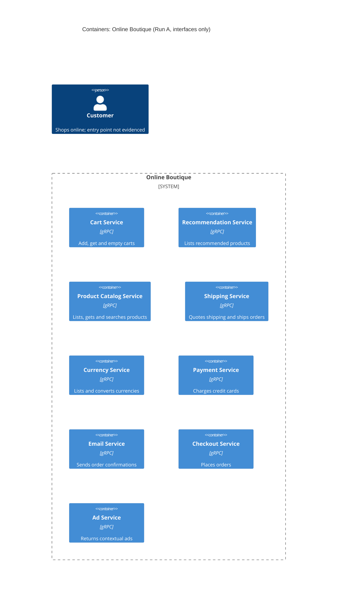

# Task 1, Run A: Recovered architecture (interfaces only)

## 1. Agent

Claude Code (Anthropic CLI), model Claude Opus 5.5 (`claude-opus-5-5`).

## 2. Files read

| File | Why |
|---|---|
| `system/online-boutique/protos/demo.proto` | The evidence for Run A |
| `prompts/1-recover-architecture.md` | The task file |
| `AGENTS.md` | Repository rules (loaded automatically) |
| `exercise/01-recover-architecture.en.md` | Read only to look up the `evidence` value for Run A, which the student had not given; not used as architectural evidence |

## 3. Containers table

Every container below is a gRPC service declared in `package hipstershop`. The proto shows **no** data stores, message brokers, web UI or external systems.

| Container | Technology / language | Responsibility | Evidence |
|---|---|---|---|
| Cart Service | gRPC (proto3); implementation language not evidenced | Add items, get a user's cart, empty a cart | `system/online-boutique/protos/demo.proto` (`service CartService`, line 23) |
| Recommendation Service | gRPC (proto3); language not evidenced | List recommended product IDs for a user and a set of products | `demo.proto` (`service RecommendationService`, line 56) |
| Product Catalog Service | gRPC (proto3); language not evidenced | List, get and search products | `demo.proto` (`service ProductCatalogService`, line 71) |
| Shipping Service | gRPC (proto3); language not evidenced | Quote shipping cost; ship an order and return a tracking ID | `demo.proto` (`service ShippingService`, line 107) |
| Currency Service | gRPC (proto3); language not evidenced | List supported currencies; convert `Money` between currencies | `demo.proto` (`service CurrencyService`, line 140) |
| Payment Service | gRPC (proto3); language not evidenced | Charge a credit card and return a transaction ID | `demo.proto` (`service PaymentService`, line 177) |
| Email Service | gRPC (proto3); language not evidenced | Send an order confirmation email | `demo.proto` (`service EmailService`, line 199) |
| Checkout Service | gRPC (proto3); language not evidenced | Place an order and return an `OrderResult` | `demo.proto` (`service CheckoutService`, line 224) |
| Ad Service | gRPC (proto3); language not evidenced | Return ads for a set of context keywords | `demo.proto` (`service AdService`, line 243) |

Note: `option go_package` (line 19) sets the package for **generated Go stubs** only. It does not show which language each service is written in.

## 4. Dependencies table

A `.proto` file declares what each service **offers**. It does not say who **calls** whom, so it shows no runtime dependencies.

| Caller → Callee | Protocol | Evidence |
|---|---|---|
| None evidenced | n/a | `demo.proto` declares services and messages only; it has no client or caller information |

Possible dependencies inferred from shared message types are listed under **Gaps**. They are not in the diagram.

## 5. Mermaid diagram

The diagram shows only what the tables show: nine gRPC containers and no `Rel`, because no dependency is evidenced. The `Person` is included as the template requires, but which container the customer uses is not evidenced (see Gaps).

## 6. Gaps

| Gap | What the proto suggests (if anything) | File that would settle it |
|---|---|---|
| **Who calls whom.** No caller is evidenced. | **[Inferred]** from shared message types: Checkout → Payment (`CreditCardInfo` used in both `PlaceOrderRequest` and `ChargeRequest`); Checkout → Email (`OrderResult` used in `PlaceOrderResponse` and `SendOrderConfirmationRequest`); Checkout → Shipping (`Address`, plus `OrderResult.shipping_tracking_id` matching `ShipOrderResponse.tracking_id`); Checkout → Currency (`PlaceOrderRequest.user_currency`); Checkout → Cart (`user_id`); Checkout → Product Catalog (cart items carry only `product_id`, while `OrderItem` carries a `cost`). Type sharing is not proof of a call. | `system/online-boutique/kubernetes-manifests/` (`*_ADDR` env vars per service); service source, e.g. `system/online-boutique/src/checkoutservice/main.go` |
| **Customer entry point.** No web frontend or HTTP API is declared in the proto, so it is unknown which container the `Person` uses. | **[Inferred]** a separate UI calls `CheckoutService`, `CartService`, `AdService` and similar, but it is not in the proto. | `system/online-boutique/kubernetes-manifests/` (a frontend Deployment/Service) |
| **Data stores.** None evidenced. | **[Inferred]** `CartService` keeps per-user state (`Cart` keyed by `user_id`), so a cart store may exist. | `system/online-boutique/kubernetes-manifests/` |
| **Message brokers / async messaging.** None evidenced; every RPC is unary request/response. | n/a | `system/online-boutique/kubernetes-manifests/` and service source |
| **External systems** (real card processor, mail provider). Not evidenced. | n/a | Payment and email service source under `system/online-boutique/src/` |
| **Implementation language per service.** Not evidenced. | `go_package` covers generated stubs only. | Service source folders under `system/online-boutique/src/` |
| **Ports, addresses, replicas, deployment topology.** Not evidenced. | n/a | `system/online-boutique/kubernetes-manifests/` |
