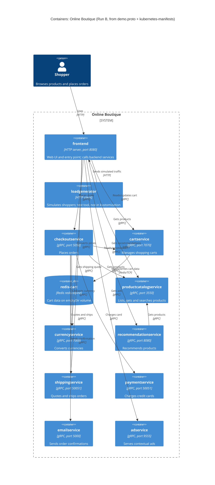

# Run B: Recovered C4 container architecture (Online Boutique)

## 1. Agent

- Product: Claude Code (Anthropic CLI)
- Model: Claude Opus 5.5 (`claude-opus-5-5`)

## 2. Files read

Task instructions:

- `prompts/1-recover-architecture.md`

Evidence:

- `system/online-boutique/protos/demo.proto`
- `system/online-boutique/kubernetes-manifests/README.md`
- `system/online-boutique/kubernetes-manifests/kustomization.yaml`
- `system/online-boutique/kubernetes-manifests/adservice.yaml`
- `system/online-boutique/kubernetes-manifests/cartservice.yaml`
- `system/online-boutique/kubernetes-manifests/checkoutservice.yaml`
- `system/online-boutique/kubernetes-manifests/currencyservice.yaml`
- `system/online-boutique/kubernetes-manifests/emailservice.yaml`
- `system/online-boutique/kubernetes-manifests/frontend.yaml`
- `system/online-boutique/kubernetes-manifests/loadgenerator.yaml`
- `system/online-boutique/kubernetes-manifests/paymentservice.yaml`
- `system/online-boutique/kubernetes-manifests/productcatalogservice.yaml`
- `system/online-boutique/kubernetes-manifests/recommendationservice.yaml`
- `system/online-boutique/kubernetes-manifests/shippingservice.yaml`

## 3. Containers table

Implementation language: **Not evidenced in the provided files** for any service. Manifests only reference unqualified image names (e.g. `image: frontend`), and `demo.proto` is language-neutral. The Technology column therefore shows the interface technology that *is* evidenced.

| Container | Technology / language | Responsibility | Evidence |
|---|---|---|---|
| `frontend` | Language not evidenced; HTTP server on port 8080, exposed via `LoadBalancer` | Web entry point for shoppers; session cookie `shop_session-id`; calls all backend services | `kubernetes-manifests/frontend.yaml` (`containerPort: 8080`, `httpGet /_healthz`, Service `frontend-external` `type: LoadBalancer`) |
| `cartservice` | Language not evidenced; gRPC on 7070 | Add items, get cart, empty cart per `user_id` | `protos/demo.proto` (`service CartService`); `kubernetes-manifests/cartservice.yaml` (port `grpc` 7070, `grpc` probes) |
| `redis-cart` | Redis (`redis:alpine`), TCP 6379 | Data store for cart service; `/data` on `emptyDir` (not persistent) | `kubernetes-manifests/cartservice.yaml` (Deployment `redis-cart`, `image: redis:alpine`, `volumes: emptyDir`) |
| `productcatalogservice` | Language not evidenced; gRPC on 3550 | List, get and search products | `protos/demo.proto` (`service ProductCatalogService`); `kubernetes-manifests/productcatalogservice.yaml` |
| `currencyservice` | Language not evidenced; gRPC on 7000 | Supported currencies; convert `Money` between currencies | `protos/demo.proto` (`service CurrencyService`); `kubernetes-manifests/currencyservice.yaml` |
| `recommendationservice` | Language not evidenced; gRPC on 8080 | Recommend product IDs for a user/product list | `protos/demo.proto` (`service RecommendationService`); `kubernetes-manifests/recommendationservice.yaml` |
| `shippingservice` | Language not evidenced; gRPC on 50051 | Shipping quote; ship order and return `tracking_id` | `protos/demo.proto` (`service ShippingService`); `kubernetes-manifests/shippingservice.yaml` |
| `checkoutservice` | Language not evidenced; gRPC on 5050 | Place order (orchestrates cart, catalog, currency, shipping, payment, email) | `protos/demo.proto` (`service CheckoutService`, `PlaceOrder`); `kubernetes-manifests/checkoutservice.yaml` (env vars) |
| `paymentservice` | Language not evidenced; gRPC on 50051 | Charge credit card, return `transaction_id` | `protos/demo.proto` (`service PaymentService`); `kubernetes-manifests/paymentservice.yaml` |
| `emailservice` | Language not evidenced; gRPC (Service port 5000 → container 8080) | Send order confirmation email | `protos/demo.proto` (`service EmailService`); `kubernetes-manifests/emailservice.yaml` (Service `port: 5000`, `targetPort: 8080`) |
| `adservice` | Language not evidenced; gRPC on 9555 | Return ads for page `context_keys` | `protos/demo.proto` (`service AdService`); `kubernetes-manifests/adservice.yaml` |
| `loadgenerator` | Language not evidenced; HTTP client | Simulates shoppers (`USERS=10`, `RATE=1`) against frontend. Test tool: commented out of `kustomization.yaml` | `kubernetes-manifests/loadgenerator.yaml` (`FRONTEND_ADDR`); `kubernetes-manifests/kustomization.yaml` line 24 |

## 4. Dependencies table

Protocol evidence: each callee's Kubernetes Service port is named `grpc`, its probes are `grpc:`, and its interface is a `service` in `demo.proto`. The caller-side env var shows *that* a call exists. *Which* RPCs each caller uses is not evidenced (see Gaps).

| Caller → callee | Protocol | Evidence (file · symbol / env var) |
|---|---|---|
| Shopper → `frontend` | HTTP | `frontend.yaml` · Service `frontend-external` (`type: LoadBalancer`, port `http` 80 → 8080) |
| `loadgenerator` → `frontend` | HTTP | `loadgenerator.yaml` · `FRONTEND_ADDR=frontend:80`; init container `wget http://${FRONTEND_ADDR}` |
| `frontend` → `productcatalogservice` | gRPC | `frontend.yaml` · `PRODUCT_CATALOG_SERVICE_ADDR=productcatalogservice:3550` |
| `frontend` → `currencyservice` | gRPC | `frontend.yaml` · `CURRENCY_SERVICE_ADDR=currencyservice:7000` |
| `frontend` → `cartservice` | gRPC | `frontend.yaml` · `CART_SERVICE_ADDR=cartservice:7070` |
| `frontend` → `recommendationservice` | gRPC | `frontend.yaml` · `RECOMMENDATION_SERVICE_ADDR=recommendationservice:8080` |
| `frontend` → `shippingservice` | gRPC | `frontend.yaml` · `SHIPPING_SERVICE_ADDR=shippingservice:50051` |
| `frontend` → `checkoutservice` | gRPC | `frontend.yaml` · `CHECKOUT_SERVICE_ADDR=checkoutservice:5050` |
| `frontend` → `adservice` | gRPC | `frontend.yaml` · `AD_SERVICE_ADDR=adservice:9555` |
| `checkoutservice` → `productcatalogservice` | gRPC | `checkoutservice.yaml` · `PRODUCT_CATALOG_SERVICE_ADDR=productcatalogservice:3550` |
| `checkoutservice` → `shippingservice` | gRPC | `checkoutservice.yaml` · `SHIPPING_SERVICE_ADDR=shippingservice:50051` |
| `checkoutservice` → `paymentservice` | gRPC | `checkoutservice.yaml` · `PAYMENT_SERVICE_ADDR=paymentservice:50051` |
| `checkoutservice` → `emailservice` | gRPC | `checkoutservice.yaml` · `EMAIL_SERVICE_ADDR=emailservice:5000` |
| `checkoutservice` → `currencyservice` | gRPC | `checkoutservice.yaml` · `CURRENCY_SERVICE_ADDR=currencyservice:7000` |
| `checkoutservice` → `cartservice` | gRPC | `checkoutservice.yaml` · `CART_SERVICE_ADDR=cartservice:7070` |
| `recommendationservice` → `productcatalogservice` | gRPC | `recommendationservice.yaml` · `PRODUCT_CATALOG_SERVICE_ADDR=productcatalogservice:3550` |
| `cartservice` → `redis-cart` | Redis protocol over TCP | `cartservice.yaml` · `REDIS_ADDR=redis-cart:6379`; Service port `tcp-redis` |

## 5. Mermaid diagram

Note: the `Rel` labels name what each callee offers (from `demo.proto`). Which RPC each caller actually invokes is not evidenced.

## 6. Gaps

| Gap | Why unresolved | File that would settle it |
|---|---|---|
| Implementation language of every service | Manifests use bare image names (`image: frontend`, …); proto is language-neutral | `system/online-boutique/src/<service>/` (Dockerfile, `go.mod`, `package.json`, `*.csproj`, `build.gradle`, `requirements.txt`) |
| `shoppingassistantservice`: does it exist? | `frontend.yaml` sets `SHOPPING_ASSISTANT_SERVICE_ADDR=shoppingassistantservice:80`, but no manifest in this folder, and `kustomization.yaml` has `../kustomize/components/shopping-assistant` commented out. Left out of diagram. | `system/online-boutique/kustomize/components/shopping-assistant/` and frontend source |
| Packaging service (`PACKAGING_SERVICE_URL`) | Commented out in `frontend.yaml`; described as optional Google Cloud demo | Frontend source; any packaging-service manifest |
| Which RPCs each caller uses (e.g. does `frontend` call `ShippingService.GetQuote` only, or `ShipOrder` too?) | Env vars show a connection, not the methods called | Caller source code, e.g. `src/frontend/`, `src/checkoutservice/` |
| Caller-side protocol | gRPC is evidenced on the callee side (port names, probes, proto). Client code is not visible. **[Inferred]** that callers use gRPC clients | Caller source code |
| External systems: real payment provider, SMTP/email provider | `PaymentService.Charge` and `EmailService.SendOrderConfirmation` exist, but no external endpoint, secret or env var. Not evidenced in the provided files. No `System_Ext` drawn | `src/paymentservice/`, `src/emailservice/` |
| Product catalog data source | No DB, volume or data-store env var in `productcatalogservice.yaml`. Not evidenced in the provided files | `src/productcatalogservice/` (e.g. a bundled products file); `kustomize/components/alloydb`, `spanner` |
| Alternative data stores (Memorystore, AlloyDB, Spanner) | Only referenced as commented-out kustomize components | `system/online-boutique/kustomize/components/` |
| Cart data durability | `redis-cart` uses `emptyDir`, so data is lost when the pod is rescheduled. Whether this is acceptable is not evidenced | Docs / ADRs on cart persistence; `kustomize/components/memorystore` |
| Observability, profiling and tracing backends | Only `ENABLE_PROFILER` / `DISABLE_PROFILER` flags; `google-cloud-operations` component commented out | `kustomize/components/google-cloud-operations/` |
| Service mesh (Istio) | `sidecar.istio.io/rewriteAppHTTPProbers` annotation on `frontend` and `loadgenerator`; no mesh config present | Istio manifests (e.g. `istio-manifests/`) |
| Network restrictions between services | `network-policies` component commented out | `kustomize/components/network-policies/` |
| Deployed image versions | `README.md` says these manifests are not directly deployable and need `skaffold` for image tags | `skaffold.yaml`; `release/kubernetes-manifests.yaml` |
