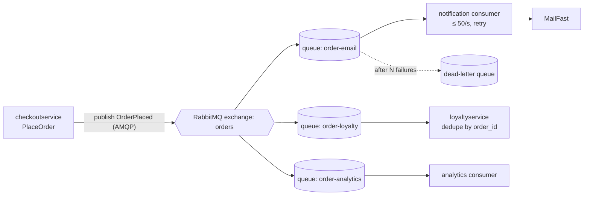

> Agent: Claude Code · Model: Claude Opus 5.5 (`claude-opus-5-5`) · Run b (example + context)

# ADR-0002: Publish an "order placed" event through RabbitMQ for post-order actions

- **Status:** Proposed
- **Date:** 2026-10-21
- **Deciders:** Not given in the provided files (see Open questions)

## Context and problem

Requirement **R-12** (`docs/scenario.md`): after an order is placed, Online Boutique must (1) send the confirmation email through **MailFast**, an external provider replacing the mock `emailservice`; (2) award **loyalty points** through a new `loyaltyservice`; (3) record an **"order placed" analytics event** for marketing. Marketing expects **more post-order actions next year** (SMS, fraud scoring, recommendations update).

**How it works today** (evidence: `system/online-boutique/src/checkoutservice/main.go`):

- `PlaceOrder` (l. 230–280) calls `paymentservice` (`chargeCard`, l. 252), `shippingservice` (`shipOrder`, l. 258), `cartservice` (`emptyUserCart`, l. 263) and then `emailservice` (`sendOrderConfirmation`, l. 273) **synchronously over gRPC**, in sequence.
- An email failure only logs a warning; the order still succeeds (l. 273–277).
- Each downstream service is a hard-wired gRPC connection set from an env var (`EMAIL_SERVICE_ADDR`, l. 115; `mustConnGRPC`, l. 122). Adding a post-order action today means changing and redeploying `checkoutservice`.
- Every order gets a unique ID from `uuid.NewUUID()` (l. 233), usable as an idempotency key.
- `checkoutservice` holds no database or persistent store (struct fields l. 66–86 are gRPC addresses and connections only).

**Facts that shape the decision** (`docs/scenario.md`, Quality goals and constraints):

| Topic | Fact | Why it matters |
|---|---|---|
| Checkout latency | p95 `PlaceOrder` ≤ **500 ms** (today approximately 300 ms) | Only approximately 200 ms of headroom left |
| Peak load | **200 orders/s** (11.11 sale) | Every post-order action must cope with this rate |
| MailFast | p95 **1.5 s**, p99 **8 s**, approximately **0.5 %** failures, limit **50 emails/s** | One synchronous MailFast call alone breaks the 500 ms budget; peak is 4× its rate limit |
| Loyalty points | within **1 minute**, **exactly once** | Needs retries *and* duplicate protection |
| Availability | an order must **never fail** because email, loyalty or analytics is down | Post-order actions must be decoupled from the order's success |
| Team | 4 devs, strong in Go and gRPC, two have used **RabbitMQ** | Favors familiar tech |
| Operations | Kubernetes; prefer **open-source, self-hosted** | Excludes cloud-only managed brokers |

**Problem:** how should `checkoutservice` trigger the three post-order actions (and future ones) without breaking the latency, availability and MailFast constraints, while giving loyalty points exactly once?

## Decision drivers

1. **Availability:** an order never fails because email, loyalty or analytics is down.
2. **Performance:** p95 `PlaceOrder` ≤ 500 ms at 200 orders/s; must not wait for MailFast (p99 8 s).
3. **Correctness of loyalty points:** awarded within 1 minute, exactly once.
4. **Respect MailFast's 50 emails/s limit** while peak is 200 orders/s.
5. **Modifiability:** add SMS, fraud scoring, recommendations next year without changing `checkoutservice` each time.
6. **Team fit and operations:** Go/gRPC skills, RabbitMQ experience, open-source self-hosted on Kubernetes.

## Considered options

1. **Extend the synchronous gRPC chain:** `checkoutservice` calls MailFast adapter, `loyaltyservice` and analytics in sequence, as it does for `emailservice` today.
2. **In-process async calls:** `checkoutservice` fires the calls in background goroutines after replying, with retries in memory.
3. **Message broker (RabbitMQ), publish/subscribe:** `checkoutservice` publishes one `OrderPlaced` event to an exchange; each action has its own queue and consumer.
4. **Event log (Apache Kafka):** `checkoutservice` writes `OrderPlaced` to a Kafka topic; each action is a consumer group.

### Pros and cons of the options

| Option | Pros | Cons |
|---|---|---|
| 1. Sync gRPC chain | Simplest; no new infrastructure; same pattern as today (`main.go` l. 273) | MailFast p95 1.5 s / p99 8 s alone exceeds 500 ms; an outage or slow call in any action delays or risks the order; 200 orders/s hits MailFast's 50/s limit directly; every new action changes `checkoutservice` |
| 2. In-process goroutines | No new infrastructure; does not add MailFast latency to the response | Work in memory is **lost if the pod restarts**, so loyalty cannot be guaranteed; no shared rate limit across `checkoutservice` replicas for MailFast; retries hold memory during a backlog; still couples `checkoutservice` to every action |
| 3. RabbitMQ pub/sub | Order returns after a short publish; durable queues survive consumer outages; a separate queue per action isolates email backlog from loyalty; consumer controls the MailFast rate (50/s); new actions = new queue, no change to `checkoutservice`; open-source, self-hostable on Kubernetes; two devs know it | New stateful component to run and monitor; at-least-once delivery, so consumers must be idempotent; publish adds a network hop to `PlaceOrder`; broker becomes a new dependency of checkout |
| 4. Kafka | Durable, replayable log (useful for analytics and for new consumers next year); very high throughput; open-source | Heavier to operate (cluster, partitions) for 200 events/s; no team experience stated; per-message retry and delay (for MailFast backoff) must be built by hand; same at-least-once and idempotency work as option 3 |

A cloud-only managed broker was not considered further because the company prefers open-source, self-hosted components (`docs/scenario.md`, Operations).

## Decision

Choose **option 3: RabbitMQ publish/subscribe**, self-hosted on the existing Kubernetes cluster.

- After payment and shipping succeed, `checkoutservice` publishes one persistent `OrderPlaced` message (`order_id` from l. 233, email, items, totals, user ID) to a durable **fanout/topic exchange** `orders`, then returns. It no longer calls `emailservice` directly (replaces l. 273–277).
- If the publish fails, `checkoutservice` logs it and **still returns success**, keeping today's rule that post-order work never fails the order (driver 1). See *Risks* for the lost-event gap.
- One durable queue and consumer per action:
  - **`order-email`** → notification consumer (replaces the mock `emailservice` logic) calls MailFast, **rate-limited to ≤ 50 emails/s** across all replicas, with retry and backoff; after N failures the message goes to a **dead-letter queue**.
  - **`order-loyalty`** → `loyaltyservice` awards points **idempotently**: it stores the processed `order_id` with a unique constraint in the same transaction as the points update, and acks only after commit. Redelivery of the same order does nothing. Result: **exactly-once effect on top of at-least-once delivery.**
  - **`order-analytics`** → analytics consumer records the event.
- Future actions (SMS, fraud scoring, recommendations) bind a new queue to the same exchange, with no change to `checkoutservice` (driver 5).

**Why not Kafka:** it would also work, but its main extra benefit (replay) is not a stated requirement, it is heavier to operate, and the team already knows RabbitMQ (driver 6). Revisit if replay or much higher volume becomes a requirement.

## Consequences

- **Positive:** `PlaceOrder` no longer waits for MailFast (p99 8 s), so the 500 ms p95 budget is protected; only a broker publish is added (performance).
- **Positive:** email, loyalty or analytics outages only grow their queue; the order still succeeds and work resumes when the consumer recovers (availability).
- **Positive:** the email queue absorbs the gap between 200 orders/s and MailFast's 50/s. Example: a 1-minute peak at 200/s leaves approximately 9,000 emails queued, drained in approximately 3 minutes at 50/s (performance / external constraint). Loyalty has its own queue, so the email backlog does not delay points (correctness).
- **Positive:** new post-order actions are added as new subscribers without touching `checkoutservice` (modifiability).
- **Positive:** uses a technology two team members know; open-source and self-hosted (cost, team fit).
- **Negative:** confirmation emails are no longer immediate; during peaks they can lag by minutes (usability).
- **Negative:** RabbitMQ is a new stateful component to deploy, monitor, upgrade and back up (operability, cost).
- **Negative:** consumers must handle duplicates and out-of-order delivery; more code paths to test (modifiability / testability).
- **Risks and mitigations:**
  - *Lost event between payment and publish* (pod crash or broker down after charging the card). `checkoutservice` has no store for a transactional outbox (`main.go` l. 66–86). Mitigation: publisher confirms + a short bounded retry; log failed publishes with `order_id` for a reconciliation job. A full outbox would need a store in checkout. **Decision needed** (see Open questions).
  - *Broker unavailable:* run RabbitMQ as a replicated cluster (e.g. quorum queues) on Kubernetes; publish failure must never fail the order.
  - *Double loyalty points:* idempotent consumer keyed on `order_id` with a unique constraint; ack only after the DB commit.
  - *MailFast failures (approximately 0.5 %) and long tails:* retries with exponential backoff, consumer timeout, DLQ with alerting.
  - *Loyalty misses the 1-minute target under peak:* scale `loyaltyservice` consumers on queue depth; alert when the oldest message age approaches 1 minute.
  - *Publish latency [Inferred]:* a persistent publish with confirms is expected to cost a few ms, but this is not measured in the provided files. Validate under load.

## Validation

- **Load test** at **200 orders/s** (e.g. with Locust) with RabbitMQ in place: p95 `PlaceOrder` stays **≤ 500 ms**.
- **Failure tests:** stop MailFast stub, `loyaltyservice` and analytics consumer in turn; **0 failed orders**, and queues drain after recovery.
- **Exactly-once test:** redeliver the same `OrderPlaced` message several times; points for that `order_id` change **once**.
- **Loyalty SLO metric:** time from order to points awarded; alert if it exceeds **1 minute** (e.g. queue oldest-message age).
- **MailFast metric:** outbound send rate never exceeds **50/s**; DLQ size near zero.
- **Review date:** after the next 11.11 sale, or before adding the first new post-order action.

## Open questions

- **Deciders:** who signs this ADR? Not given.
- **Lost-event tolerance:** is it acceptable to lose a post-order event if the broker is down when the order is placed? If not, `checkoutservice` needs a store for a transactional outbox (it has none today).
- **Peak duration** of the 11.11 sale: needed to size the email backlog and to tell customers how late a confirmation may arrive. Not given.
- **Acceptable email delay:** no target for confirmation-email latency is stated.
- **`loyaltyservice` data store and throughput:** which database, and can it handle 200 writes/s? Not given.
- **Analytics destination:** where does marketing want the event stored (database, data warehouse, a tool)? Not given.
- **MailFast details:** does MailFast support an idempotency key (to avoid duplicate emails on retry)? Is the 50/s limit per account or per API key? Not given.
- **RabbitMQ operations:** who runs and is on call for the broker? Team size is 4; operations ownership is not given.
- **Event schema and versioning:** gRPC/protobuf payload vs JSON, and how new fields are added for future consumers. Not decided here.
